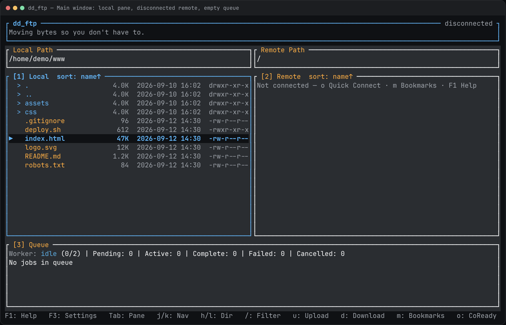

# dd_ftp

Terminal FTP/SFTP/FTPS client. Rust, ratatui, and tokio. The terminal binary is the product. A GPUI window, `dd_ftp-gui`, is in the same repo and is not feature-complete. What the terminal does is specified below. How the window catches up is in [`GUI_PARITY.md`](GUI_PARITY.md).



**Illustrated tutorial (install, first run, keys, screenshots):** [ldnddev.github.io/dd_ftp](https://ldnddev.github.io/dd_ftp/)

The in-app key table is `KEYMAP` in `crates/dd_ftp_ui/src/keys.rs`. This file matches that table. Help is a page inside Settings.

## Install

Downloads the prebuilt package for your OS and CPU (Linux, macOS, or Windows). If no package exists, the script builds from source.

```bash
curl -fsSL https://raw.githubusercontent.com/ldnddev/dd_ftp/master/install.sh | bash
```

Pin a release: `bash -s -- --version v1.9.0`.

| Flag | Installs |
|---|---|
| (no flag, with a terminal) | Asks. Default is the terminal app. |
| `--tui` | `dd_ftp` and, on Linux, its application-menu launcher |
| `--gui` | `dd_ftp-gui` and, on Linux, its launcher. Does not replace `dd_ftp_theme.yml`. |
| `--both` | Both binaries and both launchers |
| `INSTALL_GUI=1` | Same as `--both` when no target flag is passed |

From a checkout: `./install.sh`. Uninstall asks the same question and removes only that binary and its launcher. `dd_ftp_theme.yml`, `~/.config/ldnddev/dd_ftp.toml`, bookmarks, and keyring secrets stay. Full options are in the [tutorial](https://ldnddev.github.io/dd_ftp/#install).

## Run

```bash
dd_ftp
cargo run -p dd_ftp_cli
```

`F1` or `F2` opens Settings on Themes. `F3` opens Settings on Session. `Ctrl+q` quits, and asks first when a transfer is active.

The window is a separate binary. It connects and lists. Transfers are still ahead.

```bash
dd_ftp-gui
cargo run -p dd_ftp_gui --bin dd_ftp-gui
```

Launch env vars fill the quick-connect form. The protocol is always SFTP. `DD_FTP_PASS` is removed from this process after it is copied, so a child editor does not inherit it.

| Variable | Role | When unset |
|---|---|---|
| `DD_FTP_HOST` | Host | `127.0.0.1` |
| `DD_FTP_NAME` | Bookmark name | The host |
| `DD_FTP_PORT` | Port | `22` |
| `DD_FTP_USER` | Username | `user` |
| `DD_FTP_PASS` | Password (memory only) | empty |
| `DD_FTP_KEY` | Private key path | empty |
| `DD_FTP_PATH` | Initial remote path | `/` |

## Screen

- Header shows a rotating line and, while work is in flight, a four-frame mark (`▃ ▅ █ ▅`, 150ms) plus a named reason (`busy: listing remote`, `busy: scanning folder`, and the same pattern for connect, file ops, and transfers).
- Two file panes, Local and Remote, plus a queue strip. Columns are name, size, date, and permissions. `.` and `..` stay first. Name sort then puts directories before files, and reversing it flips names only. Size and date sort by that field, then name, and reverse the whole comparison. The remote pane says it is disconnected until a session exists.
- The queue is a focusable pane (`3` or Tab). With nothing pending, active, or failed it is a 3-row strip (title, worker summary, border), including when focused. Each pending, active, or failed job adds a row, up to 8, or 12 while the queue pane is focused. Completed and cancelled jobs stay in the counts and do not stretch the strip.
- Footer is a static, width-adaptive hint line. Toasts sit in a 60-column box above it. Connecting, listing, and in-progress transfers stay on the footer. Saves, bookmark changes, transfer completion and failure, disconnect, and rejected actions toast.
- A plain FTP session says it is unencrypted on the status line.

## Protocols

| Protocol | Transport | Notes |
|---|---|---|
| SFTP | SSH (`ssh2`), default port 22 | Host key is trust-on-first-use against `~/.ssh/known_hosts`. An accepted key is appended. It does not replace the old line. The SSH agent may try every key it holds. |
| FTP | Cleartext, port you type (often 21) | Data connections use the PASV port on the host you already connected to. |
| FTPS | Explicit TLS after connect (`tokio-rustls`, webpki roots) | The port is whatever you typed. Cycling the protocol does not rewrite it. |

A command argument that contains a newline or NUL is rejected. Passwords are redacted in `Debug` output and are never written to `sites.toml`.

## Connection and bookmarks

`o` opens quick connect. Fields, in order: name, host, port, username, password, private key, protocol, initial path. Tab and Shift+Tab move fields. Left and Right cycle the protocol. `Ctrl+P` on the key field opens a file picker rooted at the key path (or `~/.ssh`). Page keys work in that picker. `c` connects. `c` again, while connected, disconnects.

`m` opens bookmarks. `b` cycles the saved sites into the form without opening the modal.

| Key in the bookmark list | Action |
|---|---|
| `c` or Enter | Connect that site. Disconnects first if a session is open. |
| `e` | Load it into quick connect for editing |
| `d` | Delete, after confirm |
| `D` | Make it the default site |

`B` from the main screen saves the current quick-connect form as a bookmark. Passwords go to the OS keyring, keyed by name, username, host, and port. `@` and `_` are different characters in that key. `Ctrl+K` checks that the keyring backend answers.

Sites live in `~/.config/dd_ftp/sites.toml` (mode `0600`). `default_site` is an index. When Session has auto-connect on, startup connects that default site. The default site also fills quick connect at launch.

## Transfers

`u` uploads and `d` downloads the marked set, or the focused row when nothing is marked. Enter on a file does the same (upload from Local, download from Remote). Enter on a directory changes into it. Directories are walked and each file is queued. A single chosen upload may follow a symlink. A folder upload skips a file symlink that points outside the folder. A download refuses a symlink at the destination.

Workers run in parallel, default 2, clamped to 1–8 in Session. Each worker keeps its own SFTP or FTP session and reuses it for later jobs to the same protocol, host, port, username, and key. A dead reused session reconnects once. Disconnect drops the pool. Progress is reported about every 100ms, and the last chunk is always reported. Chunk size is 64KiB. The UI shows speed and ETA.

| Key | Action |
|---|---|
| `R` | Retry the last failed job. On the queue pane, retry the highlighted failed job. |
| `A` on the queue | Retry every failed job |
| `x` or Delete on the queue | Cancel or remove the highlighted pending, active, or failed job |
| `X` | Clear the pending queue |
| `Ctrl+C` | Cancel in-flight transfers. Ignored while Help, the filter, a prompt, or quick connect is open. |

`M` moves the marked set or the focused row to the other pane: transfer, then delete the source after success.

When the destination exists, the prompt is:

| Key | Action |
|---|---|
| `s` | Skip this file |
| `o` | Overwrite this file |
| `r` | Rename this file |
| `a` | Overwrite the rest |
| `n` | Skip the rest |
| `A` | Overwrite remaining files whose destination is newer |
| `N` | Skip remaining files whose destination is newer |
| `t` | Auto-rename remaining files whose destination is newer |
| Esc | Abort the batch |

The Session default is `ask`, `skip all`, or `overwrite all`. Newer-file policies apply only to the current batch.

## Files

Marks are per pane, by path. Space toggles the focused row and skips `.` and `..`. Shift+j/k, or Shift+click, extends from the anchor. `Ctrl+a` marks every visible row except `.` and `..`. Esc clears marks when no modal is open and compare is off. Pane titles show the mark count.

| Key | Action |
|---|---|
| `n` or `Ctrl+n` | Create. Tab switches file and folder. |
| `e` or `Ctrl+Alt+e` | Rename the focused item |
| `E` | Edit a remote file: download to a private cache, open `$VISUAL`, then `$EDITOR`, then the editor saved in Session, then `vi`. Upload if the file changed. Large files, binary files, and a remote copy that changed underneath ask first. |
| Delete or `Ctrl+Delete` | Delete the marked set or the focused row, after confirm |
| `p` | SFTP chmod on the remote pane. Octal: `755`, `0755`, or `0o755`, masked to `07777`. |
| `s` | Sort name, then size, then date, then name. One key for both panes. |
| `S` | Reverse the sort |
| `.` | Hide or show dotfiles. `.` and `..` stay visible. |
| `/` | Filter by a case-insensitive substring of the name. Esc closes and clears the pattern. Enter closes and keeps it. |
| `C` | Directory compare. Esc closes it when no modal is open. |

Compare matches names case-insensitively and skips `.` and `..`. Badges: `[L]` local only, `[R]` remote only, `[=]` same size and modified second, `[≠]` both exist and differ. A missing modified time on only one side is a difference.

Local names are checked so a path cannot escape the pane root. A new remote file is not created under a predictable system temp path. A newly created `~/.ssh` is mode `0700`.

## Navigation

| Key | Action |
|---|---|
| `1` `2` `3` | Local, Remote, Queue |
| Tab | Cycle those panes |
| `j` `k` or Up Down | Move the selection |
| PgUp PgDn | One page in lists, Help, the queue, bookmarks, and the key picker |
| Home End | First or last row in those same lists |
| `l` or Enter on a directory | Enter it |
| `h` | Parent directory |
| `r` | Refresh the focused pane |
| Click a path segment | `cd` to that prefix. Double-click the current segment for the parent. |
| Click a row | Focus that pane and select the row |
| Double-click a directory | Enter it |
| Double-click a file | Queue the transfer, same as Enter |
| Wheel, including on the scrollbar | Scroll lists, the queue, or Help |
| Drag the scrollbar | Scroll |
| Click-drag in a text field | Place the caret and select |

Local listings run off the UI thread. You can keep browsing locally while a remote folder scan fills the queue. Remote navigation waits only on the UI session (connect, list, or a file op), not on that scan.

## Settings and theme

`F1` and `F2` toggle one Settings sheet. A second press closes it and reverts an unsaved theme. Esc steps back from the color editor to the theme list, then closes and reverts. `F3` opens the sheet on Session. Pages are Themes, Session, and Help. Tab, `[`, and `]` change page, except inside a hex field, where Tab edits the field. On Session, Tab cycles fields.

Session fields, saved to `~/.config/ldnddev/dd_ftp.toml` (mode `0600`):

| Field | Values |
|---|---|
| Editor | Used when `$VISUAL` and `$EDITOR` are unset |
| Workers | 1–8, default 2 |
| Hide dotfiles | on or off |
| Overwrite | ask, skip all, overwrite all |
| Auto-connect | connect the default bookmark at startup |
| Last local path | restored when it is still a directory |

Themes load in this order: `./dd_ftp_theme.yml`, `~/.config/ldnddev/dd_ftp_theme.yml`, then built-in defaults. The Themes page lists installed Omarchy themes. Enter applies one. Editing colors and saving can write the local file or the global file, and a followed Omarchy theme stores the theme name so the next launch re-reads `colors.toml`. Token names live in [`THEME_STRUCTURE_STANDARD.md`](THEME_STRUCTURE_STANDARD.md). The visual contract is [`LDNDDEV_TUI_VISUAL_STANDARD.md`](LDNDDEV_TUI_VISUAL_STANDARD.md).

Bracketed paste inserts into the focused text field as one edit. Arrow keys, Home, End, and Ctrl+W edit inside a field.

## Window

`dd_ftp-gui` opens at 1280×800. The app id is `dev.ldnddev.dd_ftp`. Settings there is Themes, Window, Session, and Help. Window prefs (density, Vim letters, reduced motion) live in `~/.config/ldnddev/dd_ftp/gui.json` and are not read by the terminal.

The local pane matches the terminal's local browser: `.` and `..` stay first, name sort keeps directories above files, `/` filters, `.` hides other dotfiles, Space / Shift+move / Ctrl+A mark, and the path bar cds to a prefix (double-click the current segment for the parent). Quick connect matches the terminal fields. `c` opens an SFTP, FTP, or FTPS session on a worker thread and lists the initial path. `c` again disconnects. A refused SFTP host key leaves the remote pane disconnected. Plain FTP says it is unencrypted. Transfers, bookmarks-as-connect, and remote file operations are still ahead in [`GUI_PARITY.md`](GUI_PARITY.md). The terminal crates stay the behavior of record.

## License

MIT
